# Parkin’go

**Find a better spot.**

Parkin’go is a parking app concept for Miami in a Vice City look. You find a garage on a neon map from Brickell to Miami Beach, reserve a numbered bay, follow the route, check in with a QR pass, extend your time and review every receipt. The design started in Figma as a Toronto flow priced in Canadian dollars; this build adapts it to Miami in English, Spanish and Portuguese and grows it into a full account app.

- **Try it:** https://www.wendelfreitas.com/parkingo/ (the prototype is inside the case study)
- **Bare prototype:** https://www.wendelfreitas.com/parkingo/app/

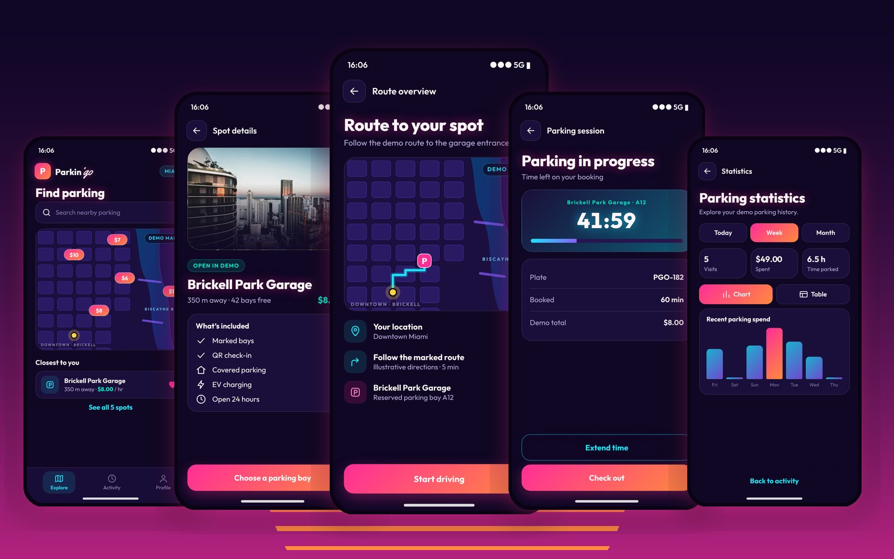

## Screens

| Explore | Search | Spot details | Choose a bay | Route |
|---|---|---|---|---|
| 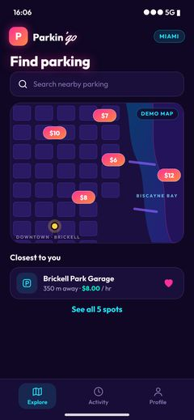 | 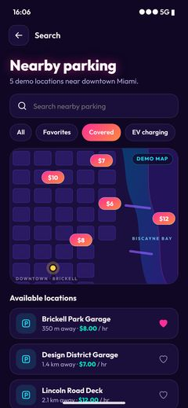 | 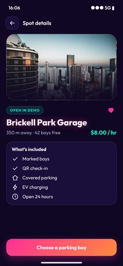 | 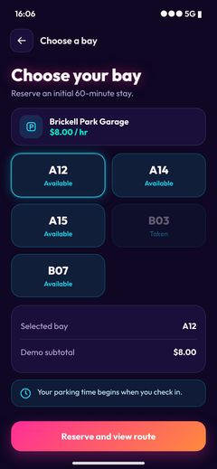 | 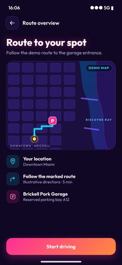 |
| **Check-in** | **Live session** | **Extend** | **Activity** | **Statistics** |
| 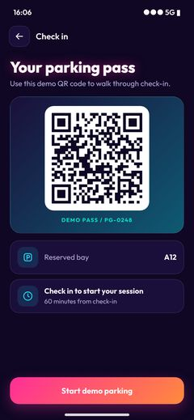 | 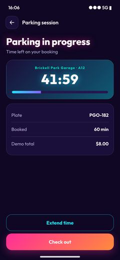 | 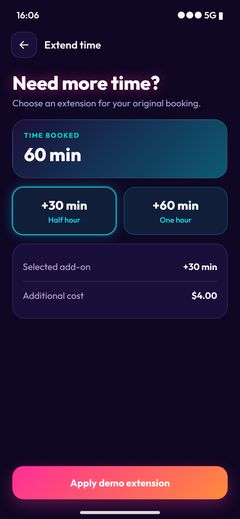 | 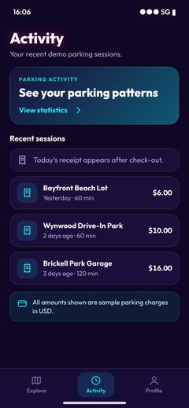 | 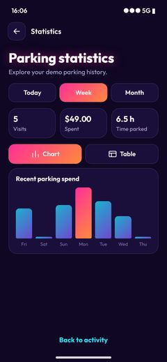 |

## What works in the prototype

- **Setup:** welcome, sign-in options, email sign-in, license plate, payment card, vehicle type and a vehicle summary, all with prefilled demo data.
- **Explore:** illustrative map of Brickell, Wynwood, Miami Beach and Biscayne Bay with a price on each pin, the closest garage and a favorites heart.
- **Search:** type a name or filter by Favorites, Covered or EV charging. The list updates as you type. Hours are checked against Eastern time, and a closed garage cannot be reserved.
- **Reserve:** spot details, a bay picker with taken bays dimmed, a route, driving directions you can step through, a trip that moves along the route and an arrival screen with the bay number.
- **Session:** a QR pass, a live countdown on Explore and Activity, extensions of 30 or 60 minutes with the extra cost, and a check-out with a star rating.
- **Account:** activity with receipts, statistics for today, week or month as a chart or a table, and a profile with vehicle, payment, favorites and language.
- English, Spanish and Portuguese, switchable from Profile or by the parent page.

On a phone the app runs full screen. On desktop it sits in a phone frame. All state lives in memory and resets on reload.

## What is in here

| Path | Contents |
|---|---|
| `app/index.html` | The whole app: one HTML file, no framework. Generated from `src/app.html`. |
| `src/` | App source and the photos that get inlined. |
| `site/case-page.html` | The portfolio case study (EN/ES/PT), generated by `scripts/build_site.py`. |
| `site/cases-app-card.snippet.html` | Script that adds the card to Cases > App on wendelfreitas.com. |
| `docs/` | Screenshots, thumbnails, cover, and the original Figma wireframe and high-fidelity boards. |
| `scripts/` | `build_app.py`, `build_site.py` and `shoot.py` (headless Chrome screenshots). |

## Running

Open `app/index.html` in a browser. URL options:

- `?lang=en|es|pt`
- `?screen=intro|welcome|options|email|plate|pay|vtype|vehicle|home|search|spot|bay|route|drive|trip|arrive|checkin|session|extend|checkout|done|activity|receipt|stats|profile`
- `?spot=brk|bay|wyn|des|lin`, `?veh=hatch|suv|moto|other`, `?q=lincoln`, `?flt=all|fav|cov|ev`, `?range=today|week|month`, `?mode=chart|table`
- `?embed` for use inside an iframe, `?bare` for a full-bleed phone view

A parent page can drive it with `postMessage({mr:'go',v:'search'})` and `postMessage({mr:'lang',v:'pt'})`.

To rebuild after editing `src/app.html`: `pip install segno && python3 scripts/build_app.py`.

## Deploy notes (wendelfreitas.com on GoDaddy)

- `app/index.html` goes to `public_html/parkingo/app/index.html`.
- `site/case-page.html` goes to `public_html/parkingo/index.html`.
- Paste `site/cases-app-card.snippet.html` before `</body>` in the site's `index.html`, next to the other case card scripts.

## Demo data and credits

Everything is sample data and nothing is saved or sent. Parkin’go is not a real parking service. The five garages are invented; the streets and neighborhoods are real. The map is an illustration, not to scale. The QR code opens the case study.

Photos are from [Unsplash](https://unsplash.com) by Zoshua Colah, Felipe Simo, Sergio Arteaga, Brice Cooper, Denys Kostyuchenko, Alin Gavriliuc and Blake Connally, reused from the Money Rescue build. They show real Miami buildings as neighborhood imagery only; none of them is a Parkin’go garage.

Designed and directed by [Wendel de Freitas](https://www.wendelfreitas.com); written with Claude.
